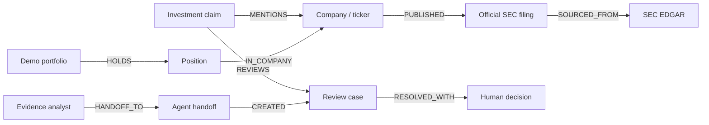

# SignalShield

**SignalShield** is an explainable, evidence-first review workflow for investment claims. It helps a retail investor, broker, or compliance team trace a claim to public company disclosures, a clearly labelled demo portfolio exposure, and an auditable human-review case.

> SignalShield is **not** investment advice, a trading bot, a suitability assessment, or a fraud detector. It flags claims for human review and shows the evidence available for that review.

## The problem

Investment information is fragmented. A confident claim can name a real ticker while omitting the official filing, the date of that filing, the source’s conflict of interest, or the investor exposure that makes the claim important. Retail investors need a fast way to check claims before acting; brokers and compliance teams need a defensible record of why an item was reviewed and what a human decided.

Tables can store claims, filings, portfolios, and cases separately, but they do not naturally answer a multi-hop question such as: **“This claim mentions two issuers—what official evidence exists, how much of the illustrative portfolio is exposed, and what happened in the last review?”**

SignalShield makes that chain visible and auditable. It intentionally avoids price prediction and automatic trading: the output is evidence, context, and a safe human-review workflow.

## Why a graph?



This gives a reviewer the evidence path—not just an opaque risk score—and lets the same connected context support action, coordination, and persistent memory.

## Hackathon track coverage

| Track | What SignalShield demonstrates | Proof in the graph |
| --- | --- | --- |
| **1 — Agents that act on connected data** | A reviewer creates a compliance review case from a source-backed claim. | `Agent → AgentHandoff → ReviewCase → Claim` |
| **2 — Agent memory and coordination** | A human outcome and rationale persist after a browser refresh or app restart. | `ReviewCase → Decision → Claim` |
| **3 — Company brain** | Claim, company, official filings, SEC source, and portfolio exposure are traversable evidence. | `Claim → Company → Disclosure → Source` and `Portfolio → Position → Company` |

## Data provenance and safety

SignalShield deliberately separates real public evidence from demo-only records.

| Data | Source | How it is used |
| --- | --- | --- |
| Company filing metadata | Official US SEC EDGAR Submissions API | Real filing form, date, accession number, source URL, and ingestion time. |
| Claims | Bundled illustrative records or user-pasted text | Clearly labelled as illustrative / user-submitted; never treated as market facts. |
| Portfolio | Bundled illustrative portfolio | Four synthetic positions used only to demonstrate exposure paths; never a real account. |

The included SEC snapshot allows the demo to run offline. Running `ingest_sec.py` refreshes the local snapshot from SEC EDGAR when internet access is available.

## Prerequisites

Install these before starting:

1. **Python 3.10+** — [python.org/downloads](https://www.python.org/downloads/)
2. **Docker Desktop** on Windows/macOS, or Docker Engine with the Compose plugin on Linux — [Docker installation docs](https://docs.docker.com/get-docker/)
3. Internet access only if you want to refresh SEC filing metadata. It is not required for the included snapshot.

Check that the tools work:

```text
python --version
docker --version
docker compose version
```

## Start here — first-time users

No FalkorDB, Docker, or Python experience is required. Open Docker first, choose your operating system below, then run the commands one at a time.

<details>
<summary><strong>Windows PowerShell — click to open</strong></summary>

1. Open PowerShell in the `signalshield` folder.
2. Create and activate an isolated Python environment:

```powershell
python -m venv .venv
Set-ExecutionPolicy -Scope Process -ExecutionPolicy RemoteSigned
.\.venv\Scripts\Activate.ps1
```

3. Install dependencies, start FalkorDB, download fresh filing metadata if possible, seed the graph, and validate it:

```powershell
python -m pip install -r requirements.txt
docker compose up -d
python ingest_sec.py
python seed_graph.py
python validate_graph.py
```

4. Start the app and open [http://localhost:8502](http://localhost:8502):

```powershell
streamlit run app.py --server.port 8502
```

If `ingest_sec.py` cannot reach SEC, skip that one command. The included local snapshot still supports the complete demo.

</details>

<details>
<summary><strong>macOS — click to open</strong></summary>

1. Open Terminal in the `signalshield` folder.
2. Create and activate an isolated Python environment:

```bash
python3 -m venv .venv
source .venv/bin/activate
```

3. Install dependencies, start FalkorDB, optionally refresh SEC metadata, seed, and validate:

```bash
python -m pip install -r requirements.txt
docker compose up -d
python ingest_sec.py
python seed_graph.py
python validate_graph.py
```

4. Start the app and open [http://localhost:8502](http://localhost:8502):

```bash
streamlit run app.py --server.port 8502
```

If SEC is unavailable, skip `python ingest_sec.py`; the checked-in snapshot is enough for the demo.

</details>

<details>
<summary><strong>Linux — click to open</strong></summary>

1. Open Terminal in the `signalshield` folder.
2. Create and activate an isolated Python environment:

```bash
python3 -m venv .venv
source .venv/bin/activate
```

3. Install dependencies and run the project:

```bash
python -m pip install -r requirements.txt
docker compose up -d
python ingest_sec.py
python seed_graph.py
python validate_graph.py
streamlit run app.py --server.port 8502
```

4. Open [http://localhost:8502](http://localhost:8502).

If Docker reports a permission error, complete Docker's official post-install steps for your distribution, reopen Terminal, and retry. Do not use `sudo` unless your Docker installation specifically requires it.

</details>

Successful validation includes:

```text
PASS watchlist companies: 4
PASS official disclosures: 48
PASS evidence paths: 6
PASS demo portfolio positions: 4
```

## View the live graph

SignalShield includes its own FalkorDB Browser at [http://localhost:3001](http://localhost:3001). This port is intentionally different from the old project’s browser on port 3000.

Select the `signalshield` graph, then paste one of the queries from [graph_queries.md](graph_queries.md). The best presentation query is:

```cypher
MATCH path = (:Claim {id: 'claim-demo-005'})-[:MENTIONS]->(:Company)<-[:IN_COMPANY]-(:Position)<-[:HOLDS]-(:Portfolio)
RETURN path
```

It visibly proves that a multi-ticker claim connects to the demo portfolio positions.

You can also inspect graph paths in the terminal:

```powershell
python inspect_graph.py
```

## How to use the app

1. Choose an illustrative claim, or select **Paste a claim for review**.
2. Review the flags. A flag means *review is needed*; it is not a finding of fraud or a recommendation.
3. Inspect the official SEC sources.
4. Review the demo portfolio exposure, if a configured ticker is mentioned.
5. Create a compliance review case.
6. Record a human outcome and rationale in **Persistent review memory**.
7. Refresh the page to confirm the decision persists.

## Resetting review history for a clean demo

To remove every saved review case, human decision, and agent handoff while keeping all companies, claims, SEC filing metadata, and demo portfolio data, run:

```powershell
python reset_review_history.py --confirm
```

Run this **before** recording. It deliberately requires `--confirm`, so a normal command run only shows what would be cleared.

## Refreshing data

Run these commands when you want current SEC filing metadata:

```powershell
python ingest_sec.py
python seed_graph.py
python validate_graph.py
```

`seed_graph.py` is idempotent: re-running it updates the graph without creating duplicate companies, filings, or demo positions.

## Troubleshooting

### `Port 8502 is not available`

SignalShield is probably already running. Open [http://localhost:8502](http://localhost:8502) instead of starting a second copy. Or use a different app port:

```powershell
streamlit run app.py --server.port 8503
```

### SEC ingestion fails

The project has a local snapshot in `data/sec_disclosures.json`. Skip `python ingest_sec.py`, then run:

```powershell
python seed_graph.py
python validate_graph.py
```

### FalkorDB is not reachable

1. Open Docker Desktop.
2. Run `docker compose up -d` from this folder.
3. Wait a few seconds and run `python seed_graph.py` again.

### I changed code but the browser shows an old page

Refresh with `Ctrl + F5` on Windows/Linux or `Cmd + Shift + R` on macOS. If necessary, stop Streamlit with `Ctrl + C` in the terminal and start it again.

### Stop the project

Press `Ctrl + C` in the terminal that runs Streamlit. To stop the database containers while keeping their persistent graph data:

```powershell
docker compose down
```

## Project structure

```text
signalshield/
├── app.py                 # Streamlit review workflow and graph visualization
├── agent.py               # Bounded, explainable review and action logic
├── graph_db.py            # SignalShield-specific FalkorDB connection helpers
├── ingest_sec.py          # Official SEC EDGAR metadata ingestion
├── seed_graph.py          # Idempotent graph seed
├── validate_graph.py      # Integration checks
├── inspect_graph.py       # Terminal evidence-path inspector
├── reset_review_history.py # Safe clean-demo reset for cases, decisions, and handoffs
├── graph_queries.md       # Copy/paste queries for FalkorDB Browser
├── compose.yaml           # Isolated FalkorDB + Browser ports and persistence
└── data/
    ├── watchlist.json
    ├── demo_claims.json
    ├── demo_portfolio.json
    └── sec_disclosures.json
```

## Sources

- [SEC EDGAR API overview](https://www.sec.gov/file/api-overview)
- [SEC investor alert on online investment offers](https://www.sec.gov/files/investor/alerts/ia_endorsement.htm)
- [FalkorDB Browser](https://github.com/FalkorDB/falkordb-browser)

## Development disclosure

AI coding assistance was used during development. The submitter reviewed the graph model, implemented and verified the project workflow, tested the FalkorDB queries and local setup, and recorded the demo.
